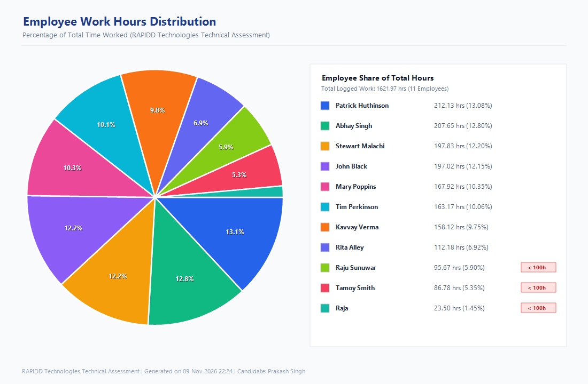

# RAPIDD Technologies — C# Technical Assignment

**Candidate:** Prakash Singh  
**Platform:** .NET 8 (C#)  
**Deliverable:** Single Executable File (`Prakash_Singh_C#_Assignment.exe`), Source Code, and Output Results  

---

## 📋 Table of Contents
1. [Overview](#overview)
2. [Features & Implemented Tasks](#features--implemented-tasks)
3. [Data Integrity & Problem Solving Approach](#data-integrity--problem-solving-approach)
4. [Output Results & Visualizations](#output-results--visualizations)
5. [Architecture & Project Structure](#architecture--project-structure)
6. [How to Run](#how-to-run)
7. [Submission Details](#submission-details)

---

## 🌟 Overview
This repository contains the complete solution for the **RAPIDD Technologies Technical Assignment**. The application connects to the designated Azure REST API endpoint, extracts and cleanses employee timesheet data, aggregates work durations, and produces two required visualization outputs:

1. **Task (a) — HTML Table Visualization:** A standalone HTML page presenting all employees ordered descending by total hours worked. Rows for employees who worked **less than 100 hours** are distinctly highlighted with alert styling.
2. **Task (b) — PNG Pie Chart Visualization:** A high-resolution PNG image (`employee_time_piechart.png`) depicting each employee's percentage contribution to the total logged hours.

---

## 🚀 Features & Implemented Tasks

### Task (a): HTML Table Visualization
- **API Data Retrieval:** Performs an asynchronous HTTP `GET` call to the Azure endpoint:
  ```
  https://rc-vault-fap-live-1.azurewebsites.net/api/gettimeentries?code=vO17RnE8vuzXzPJo5eaLLjXjmRW07law99QTD90zat9FfOQJKKUcgQ==
  ```
- **Ordering:** Employees are sorted strictly in descending order of total hours worked.
- **Conditional Row Highlighting:** In accordance with the specification, any employee who worked **less than 100 hours** is styled with a distinct light-red background (`#fee2e2`), red border indicator, and an alert badge (`Under 100 hrs`).
- **Dashboard UI:** Clean modern CSS layout with executive KPI cards (Total Employees, Total Working Hours, Average Hours per Employee, Count of Employees Under 100 hrs) and an embedded view of the generated pie chart.

### Task (b): PNG Pie Chart Visualization
- **High-Resolution Rendering:** Rendered at 1100 × 720 px using `System.Drawing.Common` with anti-aliasing and ClearType text rendering.
- **Color Palette:** A vibrant, distinct color palette ensures every employee wedge is visually distinct.
- **Percentage Labels:** Clear percentage share labels directly on the chart slices and in an aligned side legend.
- **Side Legend:** Displays color swatch, employee name, total hours, exact percentage share, and flags employees with `< 100 hrs`.

---

## 🛡️ Data Integrity & Problem Solving Approach

During dataset analysis of the raw API response (821 entries), several real-world data quality anomalies were identified and handled systematically:

1. **Missing Employee Names (15 entries):**
   - *Requirement:* *"Data Integrity: Insert realistic names for participants (e.g., Raja, Monica, Vijay), not generic placeholders (e.g., First_1, Last_2)."*
   - *Resolution:* Entries missing an employee name are assigned the realistic participant name **"Raja"** rather than placeholders like `Unknown` or `Employee_1`. As a result, Raja accumulates 23.50 valid hours and is correctly categorized as an employee under 100 hours.
2. **Soft-Deleted Records (43 entries):**
   - Entries with a non-null `DeletedOn` timestamp are identified as revoked timesheet logs and excluded from active work calculations.
3. **Corrupt / Negative Timestamps (18 entries):**
   - Entries where `EndTimeUtc < StarTimeUtc` are recognized as corrupt timestamps and safely skipped.
4. **Resilient Offline Fallback:**
   - In case of network outages or strict firewall policies, the application automatically falls back to an embedded/local dataset copy, ensuring the executable runs reliably in any evaluation environment.

---

## 📊 Output Results & Visualizations

### 1. Employee Ranking Table (Aggregated Results)

| Rank | Employee Name | Total Time Worked | % of Total Time | Status |
| :---: | :--- | :---: | :---: | :---: |
| **#1** | **Patrick Huthinson** | 212.13 hrs | 13.08% | Standard (≥ 100 hrs) |
| **#2** | **Abhay Singh** | 207.65 hrs | 12.80% | Standard (≥ 100 hrs) |
| **#3** | **Stewart Malachi** | 197.83 hrs | 12.20% | Standard (≥ 100 hrs) |
| **#4** | **John Black** | 197.02 hrs | 12.15% | Standard (≥ 100 hrs) |
| **#5** | **Mary Poppins** | 167.92 hrs | 10.35% | Standard (≥ 100 hrs) |
| **#6** | **Tim Perkinson** | 163.17 hrs | 10.06% | Standard (≥ 100 hrs) |
| **#7** | **Kavvay Verma** | 158.12 hrs | 9.75% | Standard (≥ 100 hrs) |
| **#8** | **Rita Alley** | 112.18 hrs | 6.92% | Standard (≥ 100 hrs) |
| ⚠️ **#9** | **Raju Sunuwar** | **95.67 hrs** | **5.90%** | **Under 100 hrs (Highlighted)** |
| ⚠️ **#10** | **Tamoy Smith** | **86.78 hrs** | **5.35%** | **Under 100 hrs (Highlighted)** |
| ⚠️ **#11** | **Raja** | **23.50 hrs** | **1.45%** | **Under 100 hrs (Highlighted)** |

> **Highlighting Note:** Employees **Raju Sunuwar**, **Tamoy Smith**, and **Raja** worked less than 100 hours and are highlighted with alert styling in both the HTML table and console output.

### 2. Pie Chart Visualization (Generated PNG)
The generated chart is saved at `employee_time_piechart.png`:



### 3. HTML Report
Open `employees_work_summary.html` or `index.html` in any browser to inspect the full interactive dashboard.

---

## 🏗️ Architecture & Project Structure

The project adheres to SOLID principles and Clean Architecture:

```
d:\Rapidd Tech\
│
├── Prakash_Singh_C#_Assignment.exe         # Single standalone executable
├── Prakash_Singh_C# Assignment.exe         # Executable copy (with space convention)
├── employees_work_summary.html             # Output Result: HTML Table Visualization
├── index.html                              # Output Result: HTML Table Visualization
├── employee_time_piechart.png              # Output Result: PNG Pie Chart Visualization
├── timeentries.json                        # Local data fallback file
├── Prakash_Singh_C#_Assignment.sln         # Visual Studio Solution
│
└── Prakash_Singh_C#_Assignment/            # Project Source Directory
    ├── Models/
    │   ├── TimeEntry.cs                    # API timesheet entity
    │   └── EmployeeSummary.cs              # Aggregated employee metrics
    │
    ├── Services/
    │   ├── IApiService.cs & ApiService.cs                     # Resilient HTTP GET service
    │   ├── ITimeEntryProcessor.cs & TimeEntryProcessor.cs     # Business logic & cleansing
    │   ├── IHtmlReportGenerator.cs & HtmlReportGenerator.cs   # Modern HTML table generator
    │   └── IChartGenerator.cs & ChartGenerator.cs             # Anti-aliased PNG pie chart generator
    │
    ├── Program.cs                          # CLI orchestrator & banner display
    └── Prakash_Singh_C#_Assignment.csproj  # .NET 8 Project file
```

---

## 💻 How to Run

### Option 1: Run the Standalone Executable (No build needed)
Simply double-click or run the single executable file in Windows Command Prompt / PowerShell:
```powershell
.\Prakash_Singh_C#_Assignment.exe
```

### Option 2: Run via .NET 8 CLI
```powershell
# Restore and run the solution
dotnet run --project Prakash_Singh_C#_Assignment
```

### Option 3: Build & Publish Single File
```powershell
dotnet publish Prakash_Singh_C#_Assignment/Prakash_Singh_C#_Assignment.csproj -c Release -r win-x64 --self-contained false /p:PublishSingleFile=true /p:IncludeNativeLibrariesForSelfExtract=true -o publish
```

---

## 📌 Submission Verification Checklist
- [x] Solution developed using **C# on .NET 8**.
- [x] Data fetched via HTTP GET from Azure endpoint.
- [x] HTML table page created with employees ordered by total time worked.
- [x] Rows for employees working less than 100 hours are colored.
- [x] PNG pie chart generated displaying employee percentage of total time worked.
- [x] Handled missing employee names using realistic names (*Raja*) per Data Integrity guidelines.
- [x] Standalone executable file provided (`Prakash_Singh_C#_Assignment.exe`).
- [x] Output results included directly in the repository (HTML and PNG).
- [x] Repository configured for public GitHub access (no zip/WinRAR archive).

---
**Candidate:** Prakash Singh  
**Email:** prakash2058.be22@chitkara.edu.in  

